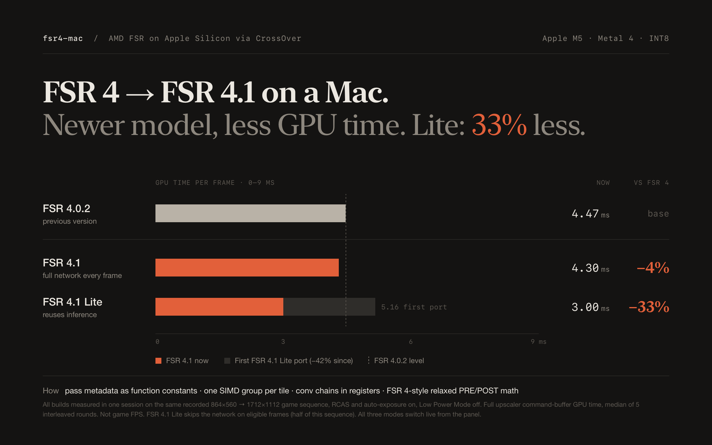
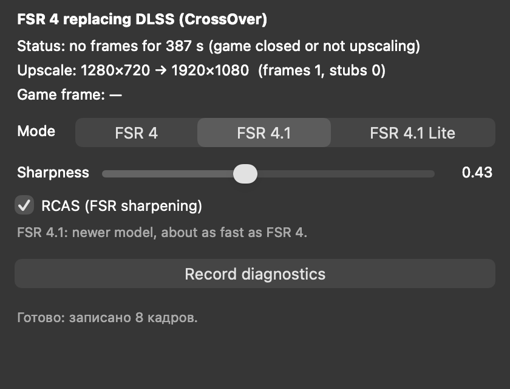

# fsr4-mac

AMD FSR 4.1.1 upscaling running natively on Apple Silicon (Metal).
Works as a standalone tool and inside games via CrossOver (DLSS → FSR 4).



**Русская инструкция:** [docs/GUIDE.md](docs/GUIDE.md)

## Requirements

- Mac with Apple Silicon (fastest on M5; M1–M4 use the `simd` half-matrix backend, not benchmarked on those chips yet, see [hardware](docs/HARDWARE.md))
- macOS 26+, Xcode 26+ with Metal Toolchain, Python 3

## Quick start: play a game in CrossOver

```sh
xcodebuild -downloadComponent MetalToolchain
make -B
python3 tools/crossover/crossover_fsr4.py install --panel --profile lossy
```

Close the game and its bottle first. Then launch the game and turn on **DLSS**.
The **FSR 4** panel lets you switch modes on the fly:



| Panel mode | What it is | Speed on M5* |
| --- | --- | ---: |
| FSR 4.1 Lite | Fastest, tiny quality trade-offs (default) | ~3.0 ms |
| FSR 4.1 | Full quality, fast math | ~4.3 ms |
| FSR 4 | Older 4.0.2 model, for comparison | ~4.5 ms |

\* 864×560 → 1712×1112 per frame.

Undo the bottle change:

```sh
python3 tools/crossover/crossover_fsr4.py restore --bottle "/path/to/cxbottle.conf"
```

More: [CrossOver details](docs/CROSSOVER.md).

## Standalone run on test frames

```sh
tools/bin/gen_testcase testcases/quality411 quality 1280 720 1920 1080 8
tools/bin/fsr4mac testcases/quality411 out/lossy --profile lossy
tools/bin/fsr4mac testcases/quality411 out/bench --profile lossy --bench 10
```

Output: PNG previews, RGBA16F `.bin` files and `run.json`.
Profiles: `lossy` (default), `exact-fast`, `exact` (bit-exact reference).

## Tests

```sh
make test
make build-fsr411-tests
make test-fsr411-gpu
```

## Documentation

| Topic | Link |
| --- | --- |
| Performance and validation | [docs/FSR411_PERFORMANCE.md](docs/FSR411_PERFORMANCE.md) |
| Benchmark method | [BENCHMARK.md](BENCHMARK.md) |
| Input format | [docs/FSR411_INPUT_CONTRACT.md](docs/FSR411_INPUT_CONTRACT.md) |
| GPU profiling | [docs/FSR411_PROFILING.md](docs/FSR411_PROFILING.md) |
| Current status and limits | [docs/STATE.md](docs/STATE.md) |
| Model sources | [third_party/fsr411/README.md](third_party/fsr411/README.md) |
| Old FSR 4.0.2 model | [architecture](docs/FSR402_ARCHITECTURE.md), [guide](docs/GUIDE_FSR402.md) |

The Lossy mode follows the numerical policy of the
[RX 7000 optimization project](https://github.com/zgauthier2000/fsr4-shader-performance-overrides)
(release `dll-2026-10-07`), implemented independently on MIT sources.
