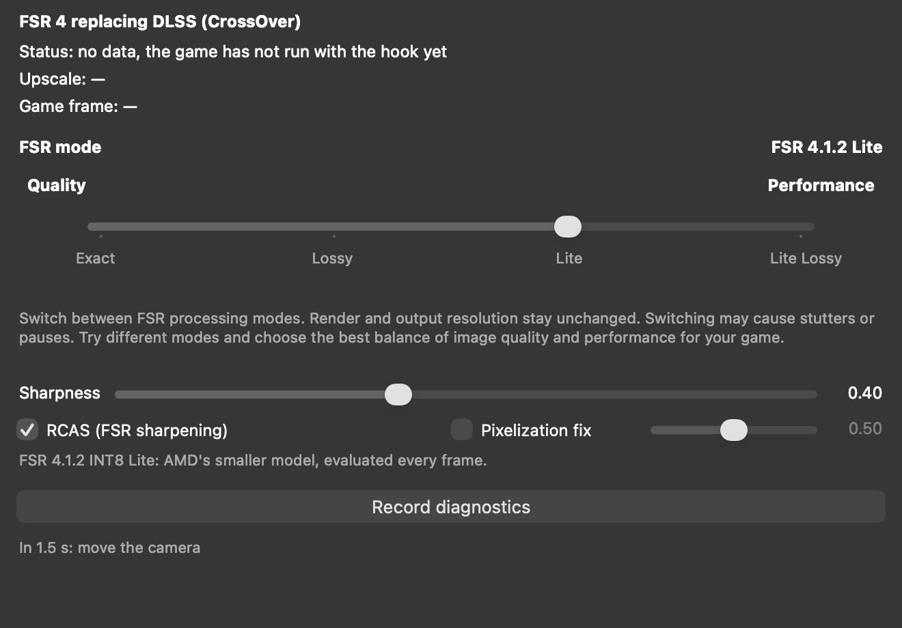

# fsr4-mac

AMD FSR 4.1.2 INT8 Lite upscaling running natively on Apple Silicon (Metal).
Works as a standalone tool and inside games via CrossOver (DLSS → FSR 4).

## M5 performance: 1080p and 1440p (v3.0)

**Fresh 2026-11-02 measurements on a fanless MacBook Air M5, 16 GB.**
Values are **whole-upscaler GPU milliseconds, not game FPS**; lower is faster.
Each value is the median of 12 round means, with **768 measured frames per
model, backend and resolution**. Observed ranges and P99 are linked below.

**MPP** is native INT8 tensor operations. **SIMD** is the forced INT8
half-matrix/float-accumulation path. **Both columns were measured on M5,
not M1-M4**; forcing SIMD keeps M5-specific POST optimizations enabled and
does not emulate an entire older GPU.

| Mode | MPP 1080p | SIMD 1080p | MPP 1440p | SIMD 1440p |
| --- | ---: | ---: | ---: | ---: |
| FSR 4.1.2 Exact (`exact-fast`) | 4.52 | 9.91 | 8.72 | 18.22 |
| FSR 4 (4.0.2, optional data)* | 5.48 | 13.22 | 10.47 | 24.12 |
| FSR 4.1.2 Lossy (`lossy2`) | 3.07 | 5.65 | 5.73 | 10.50 |
| **FSR 4.1.2 Lite (default)** | 2.78 | 4.79 | 5.37 | 8.66 |
| Lite + Pixelization fix (0.5) | 2.82 | 4.71 | 5.35 | 8.75 |
| FSR 4.1.2 Lite Lossy (optional data) | 2.96 | 3.87 | 5.84 | 7.21 |

\* The optional legacy 4.0.2 row uses its real **FP16** live encoder in the
SIMD column, not the INT8 SIMD architecture of the other rows.

### Other command-line variants

| Mode | MPP 1080p | SIMD 1080p | MPP 1440p | SIMD 1440p |
| --- | ---: | ---: | ---: | ---: |
| Exact IEEE reference (`exact`, CLI) | 5.69 | 10.95 | 11.03 | 20.24 |
| Legacy Lossy (`lossy`, retired from panel) | 3.03 | 5.69 | 5.82 | 10.55 |
| Lossy + `--temporal-quality 1` | 4.62 | 7.16 | 8.93 | 13.32 |
| Lossy + `--temporal-quality 2` | 4.14 | 6.79 | 7.98 | 12.50 |
| Lite Lossy Tiled (512, CLI-only) | 3.73 | 5.18 | 7.02 | 9.41 |
| Lite Lossy Original (CLI-only) | 8.64 | 9.16 | 10.87 | 11.85 |

Input/output: **1280x720 -> 1920x1080** and **1706x960 -> 2560x1440**.
Auto-exposure on, RCAS off, identical deterministic synthetic motion/noise
inputs. Reuse-eligible modes use 50:50 full/reused frames; tiled updates
half the tiles on every measured frame.

**Heat is included:** each backend uses 120 s initial warmup per resolution,
30 s on repeat, resolution order 1080p/1440p/1440p/1080p, and per-frame model
interleaving. MPP measured rounds were at thermal pressure **fair**; SIMD
spanned **nominal/fair**. The later 1080p Lite series was about
**20% slower in MPP and 18% slower in SIMD** than its earlier warmed series.
Both passes are retained, not replaced with the cold/best result. Thermal
pressure is not a temperature/frequency reading. Backends were collected in
separate sessions, so this is not a tightly paired cross-backend ablation.

In this fixture, Lite Lossy is slower than Lite in MPP, but about **17-19% faster
in SIMD**. Quality is not ranked here; timings depend on the scene, heat and
hardware. Small overlapping differences (e.g. the fix checkbox) are noise,
not a claimed speed improvement. CLI-only variants are not panel choices.

[Method, ranges, full/reuse costs and thermal history](docs/FSR_V3_BENCHMARKS.md).
[MPP numeric report](docs/reports/m5-modes-v3-2026-11-02.json)
| [SIMD numeric report](docs/reports/m5-modes-v3-simd-2026-11-02.json).

Older recorded-capture measurements remain in
[FSR 4.1.2 stability](docs/FSR412_STABILITY.md); they are not the tables above.

**Русская инструкция:** [docs/GUIDE.md](docs/GUIDE.md)

## Requirements

- Mac with Apple Silicon (fastest on M5; M1–M4 use the `simd` half-matrix backend, not benchmarked on those chips yet, see [hardware](docs/HARDWARE.md))
- macOS 26+, Xcode 26+ with Metal Toolchain, Python 3 (the macOS 27 SDK and
  Xcode 27 are supported)
- For games: CrossOver 24 or newer (CrossOver 26 is supported) and Rosetta 2

## Easiest: the FSR4 Installer app

1. Download **FSR4-Installer-v3.0.dmg** from the
   [latest release](https://github.com/UzenUPoZiTiV4ik/fsr4-native-macos/releases/latest)
   and drag **FSR4 Installer** to Applications.
2. First launch: the app is not notarized, so macOS blocks it. Open
   **System Settings → Privacy & Security** and press **Open Anyway**
   (or run `xattr -dr com.apple.quarantine "/Applications/FSR4 Installer.app"`).
3. The app checks Xcode, the Metal Toolchain, Rosetta and CrossOver, and
   offers a button for anything missing. CrossOver is found in /Applications
   or ~/Applications under any name; if it is elsewhere, press **Choose…**.
4. Quit the game and its bottle, pick the bottle, choose a mode and press
   **Install**. It takes about a minute. Then start the game and turn on **DLSS**.


The app keeps its files in `~/Library/Application Support/fsr4-native-macos`.
On CrossOver 24/25 it never modifies `CrossOver.app`: the bottle is pointed at
a patched copy of D3DMetal. CrossOver 26 no longer reads that redirect
variable, so there the app patches `D3DMetal.framework/Versions/A/D3DMetal`
inside CrossOver itself, keeping the original as `D3DMetal.fsr4-original`;
only that binary and `libfsr4hook.dylib` change, and macOS may ask for the
**App Management** permission. **Remove…** puts the bottle back on CrossOver's
own D3DMetal and restores the original binary. Step-by-step guide:
[docs/GUIDE.md](docs/GUIDE.md) (Russian),
[tools/crossover/INSTALL.md](tools/crossover/INSTALL.md) (English).

## Quick start from source: play a game in CrossOver

```sh
xcodebuild -downloadComponent MetalToolchain
make -B
python3 tools/fsr412_import_model.py --dll /path/to/amdvkffx64.dll --with-shaders
python3 tools/crossover/crossover_fsr4.py install --panel --fsr-version 4.1.2 --profile int8-lite
```

The model import is needed for a clean source checkout; release ZIP/DMG payloads already contain the verified model.
Close the game and its bottle first. Then launch the game and turn on **DLSS**.
The install prints `D3DMetal: … (redirect)` on CrossOver 24/25 or `(in-place)`
on 26; on 26 it patches CrossOver's own D3DMetal (the app is changed only
while installed) and the restore command below puts the original back.
The **FSR 4** panel switches processing modes with a discrete
**Quality -> Performance** slider. It applies the chosen mode after you release
the thumb, not every intermediate mode you drag across.



This is **not a resolution/preset control**: the game's render and output
resolution stay unchanged. Switching may cause stutters or pauses while
shaders are prepared and temporal history resets. Try different modes and
choose the best image-quality/performance balance for your game. The axis is
a suggested trade-off, not a measured quality ranking or a speed guarantee.

Exact, Lossy, Lite (default) and Lite Lossy are the current stops; optional
models appear only when their required data is installed. Pixelization fix
stays a separate checkbox/strength slider for Lite. **Lossy Tiled is no
longer offered in the panel**, but its CLI profile remains available. A saved
unavailable or retired mode is kept until you explicitly choose another one.

Undo the bottle change (on CrossOver 26 this also restores the original
D3DMetal; if another bottle uses the same patched framework, restore asks you
to undo that one first):

```sh
python3 tools/crossover/crossover_fsr4.py restore --bottle "/path/to/cxbottle.conf"
```

More: [CrossOver details](docs/CROSSOVER.md).

FSR 4.1.2 INT8 Lite is imported from the supplied AMD driver DLL with
`python3 tools/fsr412_import_model.py --dll /path/to/amdvkffx64.dll --with-shaders`.
The importer validates the DLL and 27,392-byte Lite initializers without
loading the Windows binary. The 4.1.2 graph uses an isolated `fsr412_` cache.
Its optimized output is byte-identical to the DLL's Lite shaders translated
to Metal ([comparison](docs/FSR412_DLL_PARITY.md)); the Windows DLL itself is
not executed.

## Standalone run on test frames

```sh
tools/bin/gen_testcase testcases/quality411 quality 1280 720 1920 1080 8
tools/bin/fsr4mac testcases/quality411 out/lite --fsr-version 4.1.2 --profile int8-lite
tools/bin/fsr4mac testcases/quality411 out/bench --fsr-version 4.1.2 --profile int8-lite --bench 10
```

Output: PNG previews, RGBA16F `.bin` files and `run.json`.
FSR 4.1.2 uses `int8-lite` (default). FSR 4.1.2 Lossy retains its internal
`lossy2` name (six trained layers, see
[docs/FSR411_LOSSY2.md](docs/FSR411_LOSSY2.md)). Use `--fsr-version 4.1.1`
for `lossy2`, `exact-fast`, `exact` (bit-exact reference) or the retired `lossy` profile.
`make lossy2-weights` downloads the pinned upstream release once and decodes
its trained weights into `build/`; they are not distributed with this MIT repository.

## Optional Lite Lossy and temporal repairs

`make lite-lossy-weights` statically imports the pinned upstream Lite Lossy
weights into `build/` (GPL-trained data, not included in the MIT release).
Use `--fsr-version 4.1.2 --profile int8-lite-lossy`; the panel also offers it
once the verified inputs are present. `int8-lite-lossy-tiled` is experimental
and CLI-only; it is not offered by the panel.
`--fsr-version 4.1.1 --profile lossy2 --temporal-quality 1` enables fine motion
and persistent-change repairs; `2` uses optional fast Wave32 notes.
Defaults are unchanged. [Implementation, tradeoffs, timings and tests](docs/FSR412_LOSSY.md).

`--profile int8-lite-lossy-original` is a different, opt-in route: it runs the
release's own PRE/BORDER/POST shaders from a verified external bundle
(`tools/fsr412/compile_original.py`) with exact native INT8 neural stages, and
matches the original-shader oracle byte for byte. It is slower than the adjusted
Lite Lossy path and is not a default.

## Experimental ANR frame generation

An independent ANR runtime can replace the **MetalFX FG that D3DMetal uses
for DLSS FG**. The game seam is 2x; native model replay and real MetalFX
Metal 3/4 hooks have been tested on M5, including Rosetta and queued frames.
Supply the local FG-V.B14 test kit to prepare model/kernel assets; they are
not distributed here. Game-specific image quality and pacing are not yet
verified. [Setup, measured cost and limitations](docs/ANR_RESEARCH.md).

## Tests

```sh
make test                 # includes the installer app tests
make test-fsr4-panel-ui    # native AppKit clicks/layout; requires a GUI session
make build-fsr411-tests
make test-fsr411-gpu
make test-fsr412-optimization
make test-fsr412-lossy      # normal/partial, native/scalar/SIMD, Metal 3/4
make test-fsr412-original   # opt-in original-graph route versus the original-shader oracle
make test-fsr411-mpp-fast  # GPU-probed M5 kernels and forced fallback
make test-fsr-pre-m5      # forced SIMD and exact Winograd
```

Build the installer app and DMG: `make installer INSTALLER_VERSION=v3.0`
(or `python3 tools/installer/build_app.py v3.0 --dmg`).

## Documentation

| Topic | Link |
| --- | --- |
| Performance and validation | [docs/FSR411_PERFORMANCE.md](docs/FSR411_PERFORMANCE.md) |
| Lite image quality update | [docs/FSR411_QUALITY_UPDATE.md](docs/FSR411_QUALITY_UPDATE.md) |
| FSR 4.1.2 Lossy (formerly Lite 2) | [docs/FSR411_LOSSY2.md](docs/FSR411_LOSSY2.md) |
| Lite Lossy, tiled inference and new temporal repairs | [docs/FSR412_LOSSY.md](docs/FSR412_LOSSY.md) |
| Original-shader oracle, geometry and POST CNB | [docs/FSR412_UPSTREAM_ORACLE.md](docs/FSR412_UPSTREAM_ORACLE.md) |
| v3.0 release notes | [docs/releases/v3.0.md](docs/releases/v3.0.md) |
| Heat-aware 1080p/1440p model measurements | [docs/FSR_V3_BENCHMARKS.md](docs/FSR_V3_BENCHMARKS.md) |
| M5 INT8 register-chain optimization | [docs/FSR_M5_INT8_OPTIMIZATION.md](docs/FSR_M5_INT8_OPTIMIZATION.md) |
| Pre-M5 SIMD optimization and exact Winograd | [docs/FSR_PRE_M5_OPTIMIZATION.md](docs/FSR_PRE_M5_OPTIMIZATION.md) |
| Latest memory optimization and timing limits | [docs/FSR411_MEMORY_OPTIMIZATION.md](docs/FSR411_MEMORY_OPTIMIZATION.md) |
| Benchmark method | [BENCHMARK.md](BENCHMARK.md) |
| Input format | [docs/FSR411_INPUT_CONTRACT.md](docs/FSR411_INPUT_CONTRACT.md) |
| GPU profiling | [docs/FSR411_PROFILING.md](docs/FSR411_PROFILING.md) |
| Current status and limits | [docs/STATE.md](docs/STATE.md) |
| Experimental Netal DLSS SR | [docs/NETAL.md](docs/NETAL.md) |
| Experimental ANR FG / MetalFX replacement | [docs/ANR_RESEARCH.md](docs/ANR_RESEARCH.md) |
| Model sources | [third_party/fsr411/README.md](third_party/fsr411/README.md) |
| Old FSR 4.0.2 model | [architecture](docs/FSR402_ARCHITECTURE.md), [guide](docs/GUIDE_FSR402.md) |

The Lossy network keeps the numerical policy of the
[RX 7000 optimization project](https://github.com/zgauthier2000/fsr4-shader-performance-overrides)
(release `dll-2026-10-07`), implemented independently on MIT sources. Selected
temporal fixes through October 14, the October 15 dark-band guard and the
October 29 depth-edge clamp retain thin detail and update effects without motion vectors. A separate PRE for reused frames
removes unused network-input work; see the quality update for measurements.
