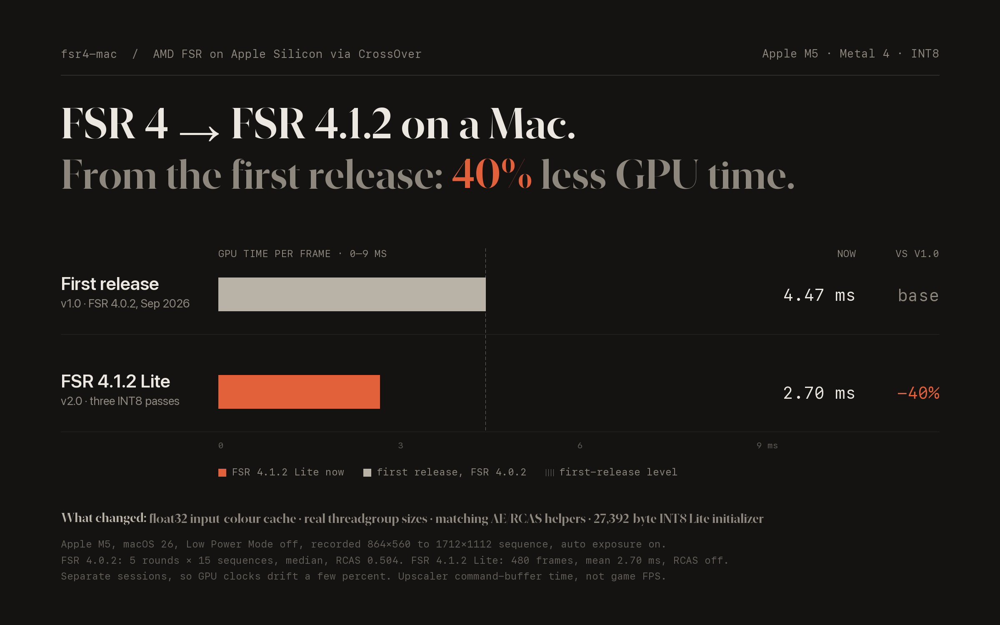

# fsr4-mac

AMD FSR 4.1.2 INT8 Lite upscaling running natively on Apple Silicon (Metal).
Works as a standalone tool and inside games via CrossOver (DLSS → FSR 4).



The first release ran AMD's FSR 4.0.2 network at **4.47 ms** mean GPU time per
frame on an M5; the current **4.1.2 Lite** does 2.70 ms on the same recorded
sequence, 40% less. Method and limits: [FSR 4.1.2 stability](docs/FSR412_STABILITY.md).

**Русская инструкция:** [docs/GUIDE.md](docs/GUIDE.md)

## Requirements

- Mac with Apple Silicon (fastest on M5; M1–M4 use the `simd` half-matrix backend, not benchmarked on those chips yet, see [hardware](docs/HARDWARE.md))
- macOS 26+, Xcode 26+ with Metal Toolchain, Python 3
- For games: CrossOver 24+ and Rosetta 2

## Easiest: the FSR4 Installer app

1. Download **FSR4-Installer-v2.0.dmg** from the
   [latest release](https://github.com/UzenUPoZiTiV4ik/fsr4-native-macos/releases/latest)
   and drag **FSR4 Installer** to Applications.
2. First launch: the app is not notarized, so macOS blocks it. Open
   **System Settings → Privacy & Security** and press **Open Anyway**
   (or run `xattr -dr com.apple.quarantine "/Applications/FSR4 Installer.app"`).
3. The app checks Xcode, the Metal Toolchain, Rosetta and CrossOver, and
   offers a button for anything missing. CrossOver is found in /Applications
   or ~/Applications under any name; if it is elsewhere, press **Choose…**.
4. Quit the game and its bottle, pick the bottle, choose a mode and press
   **Install**. It takes about a minute. Then start the game and turn on **DLSS**.


The app keeps its files in `~/Library/Application Support/fsr4-native-macos`
and never modifies CrossOver.app. **Remove…** puts the bottle back on
CrossOver's own D3DMetal. Step-by-step guide:
[docs/GUIDE.md](docs/GUIDE.md) (Russian),
[tools/crossover/INSTALL.md](tools/crossover/INSTALL.md) (English).

## Quick start from source: play a game in CrossOver

```sh
xcodebuild -downloadComponent MetalToolchain
make -B
python3 tools/fsr412_import_model.py --dll /path/to/amdvkffx64.dll --with-shaders
python3 tools/crossover/crossover_fsr4.py install --panel --fsr-version 4.1.2 --profile int8-lite
```

The model import is needed for a clean source checkout; release ZIP/DMG payloads already contain the verified model.
Close the game and its bottle first. Then launch the game and turn on **DLSS**.
The **FSR 4** panel lets you switch modes on the fly:


| Panel mode | What it is | Speed on M5* |
| --- | --- | ---: |
| FSR 4.1.2 Lite | Three-pass AMD INT8 Lite model (default) | 2.70 ms mean* |
| FSR 4.1 Lossy | Former Lite 2, six trained layers (`lossy2`) | 2.78 ms mean with reuse* |
| FSR 4.1 | Full quality, fast math | ~4.3 ms |
| FSR 4 | Older 4.0.2 model, for comparison | ~4.5 ms |

\* Recorded 864×560 → 1712×1112 sequence on M5, 480 measured frames per model,
interleaved runs, RCAS off. FSR 4.1.2: P99 3.87 ms, maximum 4.93 ms, full
inference on every frame. FSR 4.1 Lossy: maximum 5.56 ms, 240 neural frames
and 240 inference reuses. [Method and validation](docs/FSR412_STABILITY.md).
These are standalone replay GPU times, not a guaranteed ceiling in a running game.
The old FSR 4.1 Lite mode has been removed from the panel.

Undo the bottle change:

```sh
python3 tools/crossover/crossover_fsr4.py restore --bottle "/path/to/cxbottle.conf"
```

More: [CrossOver details](docs/CROSSOVER.md).

FSR 4.1.2 INT8 Lite is imported from the supplied AMD driver DLL with
`python3 tools/fsr412_import_model.py --dll /path/to/amdvkffx64.dll --with-shaders`.
The importer validates the DLL and 27,392-byte Lite initializers without
loading the Windows binary. The 4.1.2 graph uses an isolated `fsr412_` cache.
Its optimized output is byte-identical to the DLL's Lite shaders translated
to Metal ([comparison](docs/FSR412_DLL_PARITY.md)); the Windows DLL itself is
not executed.

## Standalone run on test frames

```sh
tools/bin/gen_testcase testcases/quality411 quality 1280 720 1920 1080 8
tools/bin/fsr4mac testcases/quality411 out/lite --fsr-version 4.1.2 --profile int8-lite
tools/bin/fsr4mac testcases/quality411 out/bench --fsr-version 4.1.2 --profile int8-lite --bench 10
```

Output: PNG previews, RGBA16F `.bin` files and `run.json`.
FSR 4.1.2 uses `int8-lite` (default). FSR 4.1 Lossy retains its internal
`lossy2` name (six trained layers, see
[docs/FSR411_LOSSY2.md](docs/FSR411_LOSSY2.md)). Use `--fsr-version 4.1.1`
for `lossy2`, `exact-fast`, `exact` (bit-exact reference) or the retired `lossy` profile.
`make lossy2-weights` fetches the pinned trained weights
once into `build/`; they are not distributed with this MIT repository.

## Tests

```sh
make test                 # includes the installer app tests
make build-fsr411-tests
make test-fsr411-gpu
make test-fsr412-optimization
```

Build the installer app and DMG: `make installer INSTALLER_VERSION=v1.8`
(or `python3 tools/installer/build_app.py v1.8 --dmg`).

## Documentation

| Topic | Link |
| --- | --- |
| Performance and validation | [docs/FSR411_PERFORMANCE.md](docs/FSR411_PERFORMANCE.md) |
| Lite image quality update | [docs/FSR411_QUALITY_UPDATE.md](docs/FSR411_QUALITY_UPDATE.md) |
| FSR 4.1 Lossy (formerly Lite 2) | [docs/FSR411_LOSSY2.md](docs/FSR411_LOSSY2.md) |
| Latest memory optimization and timing limits | [docs/FSR411_MEMORY_OPTIMIZATION.md](docs/FSR411_MEMORY_OPTIMIZATION.md) |
| Benchmark method | [BENCHMARK.md](BENCHMARK.md) |
| Input format | [docs/FSR411_INPUT_CONTRACT.md](docs/FSR411_INPUT_CONTRACT.md) |
| GPU profiling | [docs/FSR411_PROFILING.md](docs/FSR411_PROFILING.md) |
| Current status and limits | [docs/STATE.md](docs/STATE.md) |
| Model sources | [third_party/fsr411/README.md](third_party/fsr411/README.md) |
| Old FSR 4.0.2 model | [architecture](docs/FSR402_ARCHITECTURE.md), [guide](docs/GUIDE_FSR402.md) |

The Lossy network keeps the numerical policy of the
[RX 7000 optimization project](https://github.com/zgauthier2000/fsr4-shader-performance-overrides)
(release `dll-2026-10-07`), implemented independently on MIT sources. Selected
temporal fixes from releases through `dll-2026-10-14` retain more thin detail
and update effects without motion vectors. A separate PRE for reused frames
removes unused network-input work; see the quality update for measurements.
