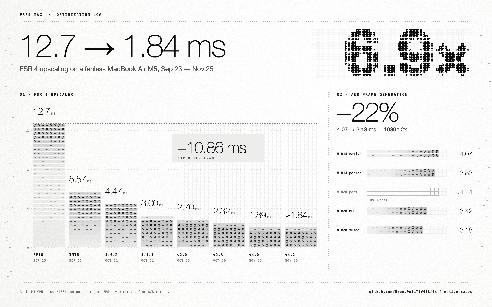
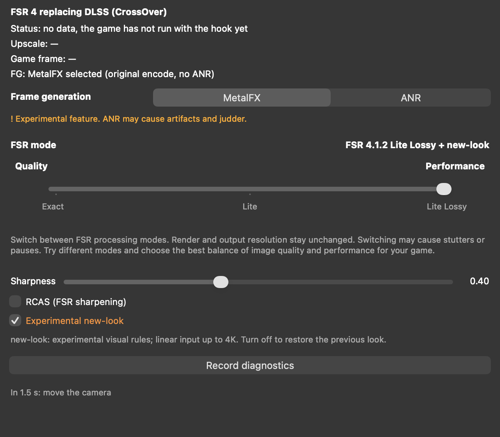

# fsr4-mac

`FSR4-MAC  /  NATIVE METAL  /  APPLE SILICON  /  v4.2`

AMD **FSR 4.1.2 INT8 Lite** upscaling and **ANR frame generation**, running natively on Apple Silicon.
Works as a standalone tool and inside games via CrossOver (**DLSS → FSR 4**).



`12.7 → 1.84 ms  ·  6.9× faster upscaling  ·  −22% frame generation  ·  GPU time on a fanless M5, not game FPS`

Full numbers: [v4.2](docs/releases/v4.2.md) · [v4.0](docs/releases/v4.0.md) · [v3.0 model timings](docs/FSR_V3_BENCHMARKS.md) · [method](BENCHMARK.md)

---

## 01 / Requirements

| | |
| --- | --- |
| **Mac** | Apple Silicon. Fastest on M5; M1-M4 use the `simd` backend, not benchmarked on those chips yet ([hardware](docs/HARDWARE.md)) |
| **macOS** | 26+ with Xcode 26+ and the Metal Toolchain (macOS 27 SDK / Xcode 27 supported) |
| **Tools** | Python 3 |
| **Games** | CrossOver 24 or newer (26 supported) and Rosetta 2 |

---

## 02 / Install with the app

1. Download **FSR4-Installer-v4.2.dmg** from the
   [latest release](https://github.com/UzenUPoZiTiV4ik/fsr4-native-macos/releases/latest)
   and drag **FSR4 Installer** to Applications.
2. First launch: the app is not notarized. Open **System Settings → Privacy & Security → Open Anyway**
   (or `xattr -dr com.apple.quarantine "/Applications/FSR4 Installer.app"`).
3. The app checks Xcode, the Metal Toolchain, Rosetta and CrossOver and offers a button for anything missing.
   CrossOver is found under any name; otherwise press **Choose…**.
4. Quit the game and its bottle, pick the bottle and a mode, press **Install** (about a minute).
   Start the game and turn on **DLSS**.


> **What gets changed.** Files live in `~/Library/Application Support/fsr4-native-macos`.
> CrossOver 24/25: `CrossOver.app` is never touched, the bottle points at a patched copy of D3DMetal.
> CrossOver 26: the app patches `D3DMetal.framework/Versions/A/D3DMetal` in place, keeps the original as
> `D3DMetal.fsr4-original` and may ask for **App Management**. **Remove…** restores everything.

Step-by-step: [GUIDE.md](docs/GUIDE.md) (Russian) · [INSTALL.md](tools/crossover/INSTALL.md) (English)

---

## 03 / Install from source

```sh
xcodebuild -downloadComponent MetalToolchain
make -B
python3 tools/fsr412/import_model.py --dll /path/to/amdvkffx64.dll --with-shaders
python3 tools/crossover/crossover_fsr4.py install --panel --fsr-version 4.1.2 --profile int8-lite
```

- The model import is only needed for a clean checkout; release ZIP/DMG payloads already contain it.
- The importer validates the DLL and its 27,392-byte Lite initializers **without executing** the Windows binary.
- Output is byte-identical to the DLL's Lite shaders translated to Metal ([parity](docs/FSR412_DLL_PARITY.md)).
- The install prints `D3DMetal: … (redirect)` on CrossOver 24/25 or `(in-place)` on 26.

Undo the bottle change (on 26 this also restores the original D3DMetal):

```sh
python3 tools/crossover/crossover_fsr4.py restore --bottle "/path/to/cxbottle.conf"
```

More: [CrossOver details](docs/CROSSOVER.md)

---

## 04 / The panel



| Control | What it does |
| --- | --- |
| **Quality → Performance** | Picks a processing mode: Exact, Lossy, **Lite (default)**, Lite Lossy. Applies on release |
| **Pixelization fix** | Separate checkbox and strength slider for Lite |
| **Experimental new-look** | Default-off rules for particles, thin lines and depth edges in Lite Lossy ([limits](docs/FSR412_NEW_LOOK.md)) |
| **MetalFX · ANR 2x · ANR 3x** | Frame generation engine, switchable live |

- This is **not a resolution preset**: render and output resolution stay the same.
- Switching can stutter for a moment while shaders build and history resets.
- Optional modes appear only when their data is installed. Lossy Tiled is CLI-only now.

---

## 05 / ANR frame generation `experimental`

A native Metal ANR runtime replaces the **MetalFX FG that D3DMetal uses for DLSS FG**.
Turn on DLSS Frame Generation in the game.

| | |
| --- | --- |
| **Model** | FG-V.B20 (`fsr4_anr_runtime_v2`); legacy FG-V.B14 still works for 2x |
| **Resolution** | Any size from `640x360` to `7680x4320`, including `1710x1073` |
| **Color** | Native `srgb8`, `pq10`, `scrgb16`, no round-trip conversion |
| **Modes** | `ANR 2x` and `ANR 3x` (`t=1/3` and `t=2/3` from one pair pass) |
| **M5 cost** | **3.18 ms** in 2x, **4.69 ms** in 3x (1080p PQ10) |

```sh
python3 tools/anr/prepare.py --addon /path/to/anr-fg-V.B20-addon.zip --output build/anr_runtime_v20
```

ANR weights and compiled shaders stay local under `build/` and are never distributed.
3x pacing in arbitrary games is still experimental. [Setup, cost and limits](docs/ANR_RESEARCH.md)

---

## 06 / Standalone run

```sh
tools/bin/gen_testcase testcases/quality411 quality 1280 720 1920 1080 8
tools/bin/fsr4mac testcases/quality411 out/lite --fsr-version 4.1.2 --profile int8-lite
tools/bin/fsr4mac testcases/quality411 out/bench --fsr-version 4.1.2 --profile int8-lite --bench 10
```

Output: PNG previews, RGBA16F `.bin` files and `run.json`.

| Profile | Version | Notes |
| --- | --- | --- |
| `int8-lite` | 4.1.2 | Default |
| `int8-lite-lossy` | 4.1.2 | Needs `make lite-lossy-weights` ([details](docs/FSR412_LOSSY.md)) |
| `int8-lite-lossy-tiled` | 4.1.2 | Experimental, CLI-only |
| `lossy2` | 4.1.1 | FSR 4.1.2 Lossy, needs `make lossy2-weights` ([details](docs/FSR411_LOSSY2.md)) |
| `exact-fast` / `exact` | 4.1.1 | `exact` is the bit-exact reference |

- Optional weights are fetched from pinned upstream releases into `build/`; GPL-trained data is not part of this MIT repository.
- `--temporal-quality 1` enables fine motion and persistent-change repairs for `lossy2`; `2` adds fast Wave32 notes.

---

## 07 / Tests

```sh
make test                   # includes the installer app tests
make test-fsr4-panel-ui     # native AppKit clicks/layout, needs a GUI session
make build-fsr411-tests
make test-fsr411-gpu
make test-fsr412-optimization
make test-fsr412-lossy      # normal/partial, native/scalar/SIMD, Metal 3/4
make test-fsr411-mpp-fast   # GPU-probed M5 kernels and forced fallback
make test-fsr-pre-m5        # forced SIMD and exact Winograd
```

Installer app and DMG: `make installer INSTALLER_VERSION=v4.2`

---

## 08 / Repository map

| Path | Contents |
| --- | --- |
| `src/common/` | Shared device, backend and input helpers |
| `src/live/` | Live-game hook layer and panel |
| `src/fsr41x/` | FSR 4.1.1 / 4.1.2 runtimes and Metal kernels ([runtime](src/fsr41x/fsr411_runtime.h), [session](src/fsr41x/fsr412_session.inc)) |
| `src/fsr402/` | Legacy FSR 4.0.2 runtime |
| `src/anr/` | Experimental ANR frame generation |
| `src/netal/` · `src/cli/` | Netal input layer · standalone CLI binaries |
| `hook/` | MetalFX interception ([fsr4_metalfx.m](hook/fsr4_metalfx.m)) |
| `tools/` | Per-model importers and weight pipelines, CrossOver, installer, bench, diagnostics |
| `tests/` | Mirrors the `src/` split |
| `build/` · `dist/` | Generated: binaries, shader caches, weights · live hook, releases |

---

## 09 / Documentation

| Release notes | |
| --- | --- |
| **v4.2** ANR kernel/runtime and FSR 4.1.2 PRE/POST speedups | [docs/releases/v4.2.md](docs/releases/v4.2.md) |
| **v4.1** ANR FG-V.B20, 3x frame generation, M5 MPP | [docs/releases/v4.1.md](docs/releases/v4.1.md) |
| **v4.0** Faster Lite Lossy, wider Winograd, MPP fast paths | [docs/releases/v4.0.md](docs/releases/v4.0.md) |
| **v3.3** Lossy weights and macOS 27 hook fix | [docs/releases/v3.3.md](docs/releases/v3.3.md) |
| **v3.2** Hook startup fix and experimental new-look | [docs/releases/v3.2.md](docs/releases/v3.2.md) |
| **v3.0** Quality/performance panel | [docs/releases/v3.0.md](docs/releases/v3.0.md) |
| All releases | [CHANGELOG.md](CHANGELOG.md) |

| Performance | |
| --- | --- |
| Heat-aware 1080p/1440p model timings | [FSR_V3_BENCHMARKS.md](docs/FSR_V3_BENCHMARKS.md) |
| M5 INT8 register chains | [FSR_M5_INT8_OPTIMIZATION.md](docs/FSR_M5_INT8_OPTIMIZATION.md) |
| Pre-M5 SIMD and exact Winograd | [FSR_PRE_M5_OPTIMIZATION.md](docs/FSR_PRE_M5_OPTIMIZATION.md) |
| Memory optimization and timing limits | [FSR411_MEMORY_OPTIMIZATION.md](docs/FSR411_MEMORY_OPTIMIZATION.md) |
| Performance and validation | [FSR411_PERFORMANCE.md](docs/FSR411_PERFORMANCE.md) |
| Benchmark method · GPU profiling | [BENCHMARK.md](BENCHMARK.md) · [FSR411_PROFILING.md](docs/FSR411_PROFILING.md) |

| Models and internals | |
| --- | --- |
| Lite image quality update | [FSR411_QUALITY_UPDATE.md](docs/FSR411_QUALITY_UPDATE.md) |
| FSR 4.1.2 Lossy (formerly Lite 2) | [FSR411_LOSSY2.md](docs/FSR411_LOSSY2.md) |
| Lite Lossy, tiled inference, temporal repairs | [FSR412_LOSSY.md](docs/FSR412_LOSSY.md) |
| Experimental new-look | [FSR412_NEW_LOOK.md](docs/FSR412_NEW_LOOK.md) |
| Original-shader oracle, geometry, POST CNB | [FSR412_UPSTREAM_ORACLE.md](docs/FSR412_UPSTREAM_ORACLE.md) |
| ANR FG / MetalFX replacement | [ANR_RESEARCH.md](docs/ANR_RESEARCH.md) |
| Input format · status and limits | [FSR411_INPUT_CONTRACT.md](docs/FSR411_INPUT_CONTRACT.md) · [STATE.md](docs/STATE.md) |
| Model sources | [third_party/fsr411/README.md](third_party/fsr411/README.md) |
| Old FSR 4.0.2 model | [architecture](docs/FSR402_ARCHITECTURE.md) · [guide](docs/GUIDE_FSR402.md) |

---

`CREDITS`

The Lossy network keeps the numerical policy of the
[FSR 4 performance project](https://github.com/zgauthier2000/fsr4-shader-performance-overrides)
(release `dll-2026-10-07`), implemented independently on MIT sources. Temporal fixes through October 14,
the October 15 dark-band guard and the October 29 depth-edge clamp keep thin detail and update effects
without motion vectors; a separate PRE for reused frames removes unused network-input work
([measurements](docs/FSR411_QUALITY_UPDATE.md)).
